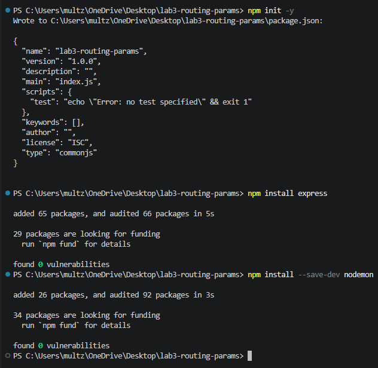
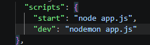
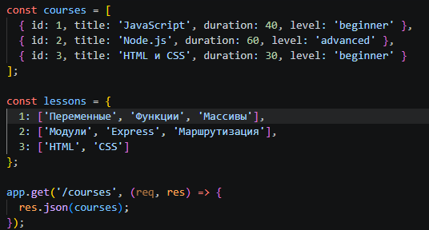
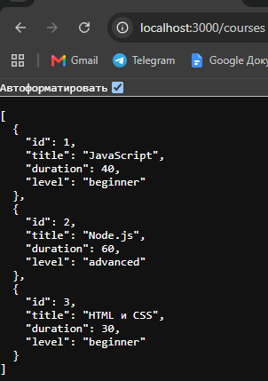
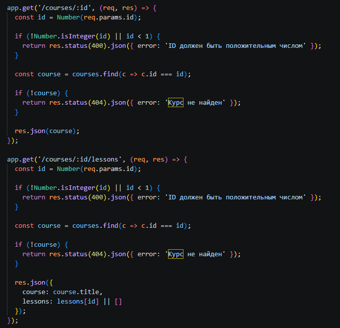
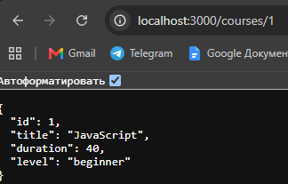
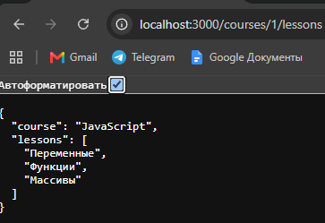
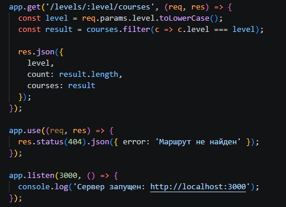
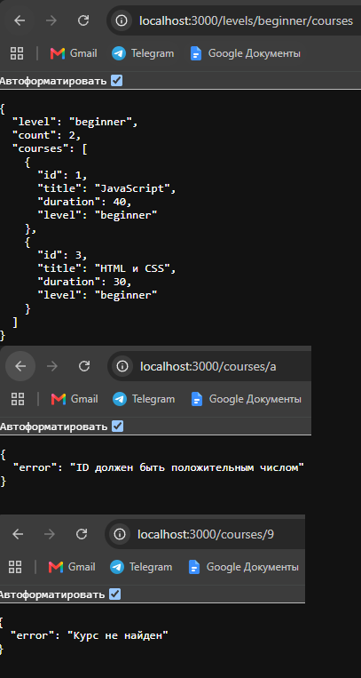

https://github.com/NXGHTMXRE007/lab3-routing-params

# Лабораторная работа №3 Маршрутизация и параметры URL

**Студент:** Евдокимов Иван Александрович
**Группа:** ПИЖ-б-о-25-2(1)
**Вариант:** 9

## Цель работы
Освоить различные способы передачи данных через
URL. Научиться строить гибкие маршруты с параметрами пути и queryпараметрами, комбинировать их,
обрабатывать вложенные ресурсы и валидировать входные данные. 
Понять разницу между req.params, req.query и req.body.


## Выполнение практического  задания
Маршрутизация — это механизм, который определяет, какой обработчик выполнится при обращении к определённому URL. В Express маршруты создаются с помощью методов app.get(), app.post() и других.
  

  

  

  

  

  

  

  

  
```bash
Контрольные вопросы
1. Что такое маршрутизация?
Маршрутизация — это определение обработчика запроса по URL и HTTP-методу. В Express используются методы app.get(), app.post(), во Flask — декораторы @app.route().

2. Чем отличаются req.params, req.query и req.body?
req.params — параметры пути, req.query — параметры URL после ?, req.body — данные тела запроса.

3. Как получить параметр пути в Express? Во Flask?
В Express — через req.params.id, во Flask — через параметр функции, указанный в маршруте.

4. Что произойдёт, если не преобразовать параметр пути в число?
Параметр останется строкой, поэтому сравнение с числовым ID может работать неправильно.

5. Как обработать ситуацию, когда параметр пути отсутствует?
Проверить наличие параметра и вернуть соответствующий ответ либо обработать запрос как несуществующий маршрут.

6. Что такое вложенные маршруты? Приведите пример.
Это маршруты для связанных ресурсов, например /courses/1/lessons — уроки курса с ID 1.

7. Какой код ответа возвращается, если ресурс не найден?
404 Not Found.

8. Какой код ответа возвращается при невалидном параметре?
400 Bad Request.

9. Как объявить необязательный параметр пути в Express?
В Express 4 используется синтаксис :id?, например /courses/:id?. В Express 5 синтаксис отличается.

10. Как работает порядок объявления маршрутов в Express? Почему он важен?
Маршруты проверяются по порядку объявления. Порядок важен, чтобы более общие маршруты не мешали обработке конкретных запросов.
```